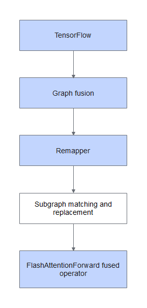
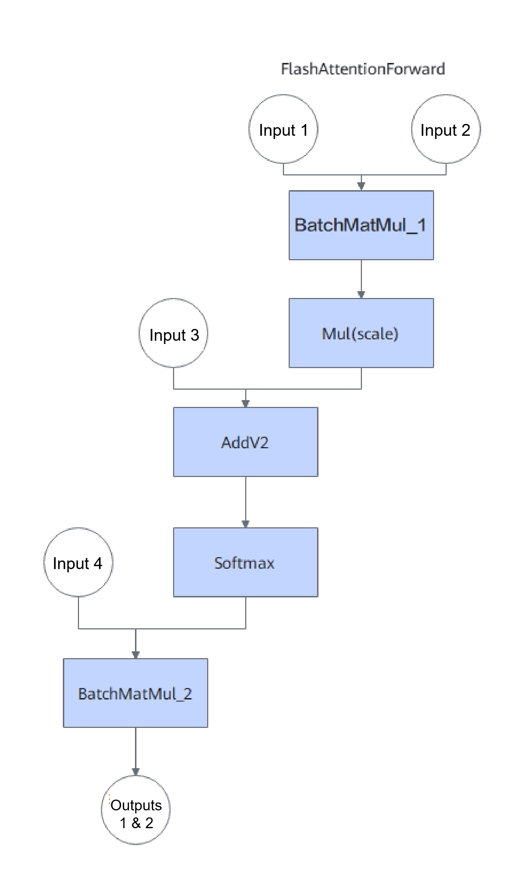
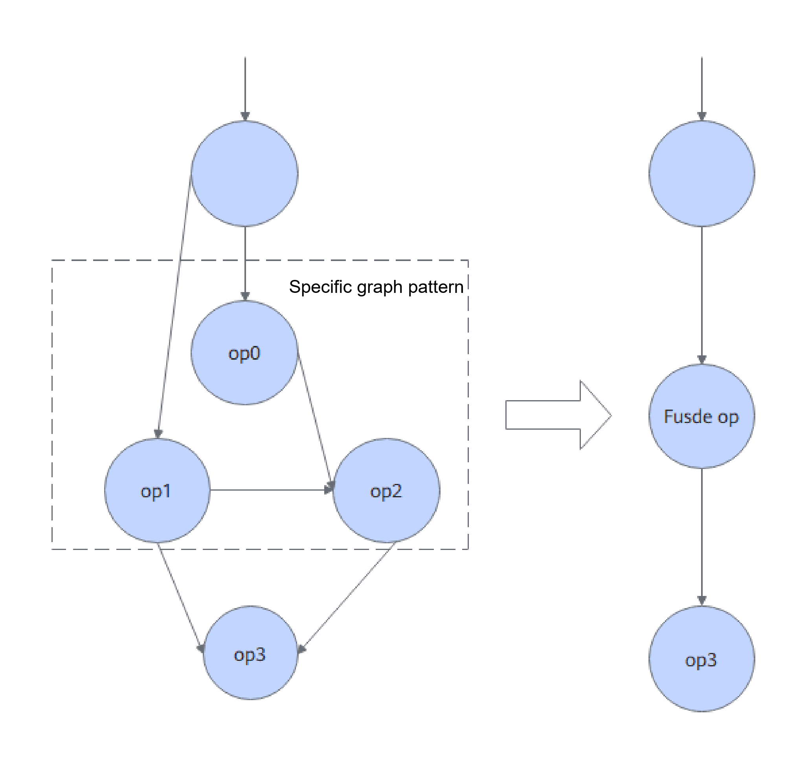
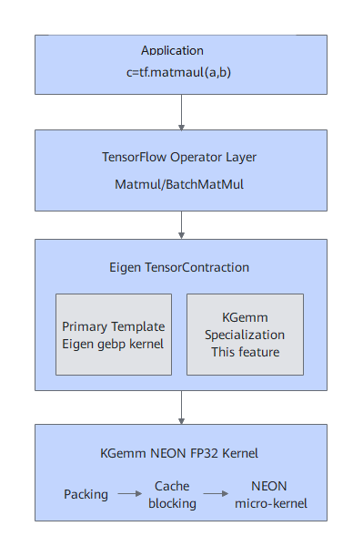
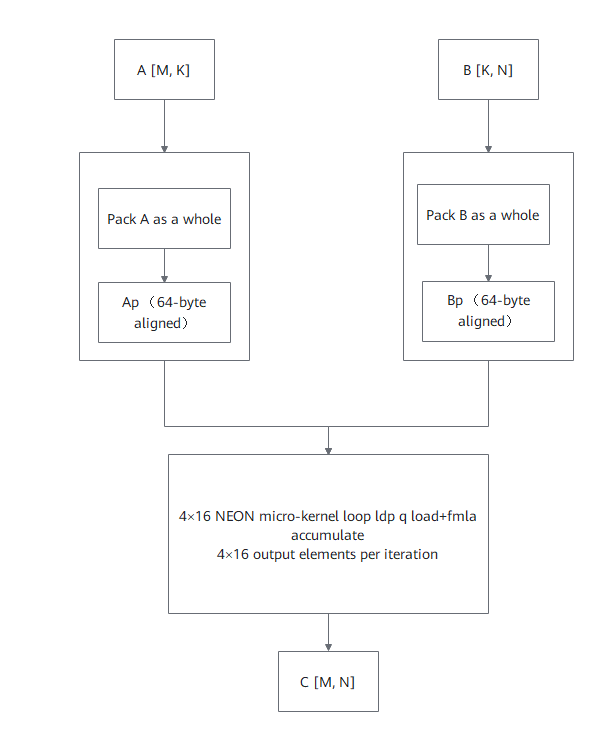

# Feature Introduction

<!-- md-trans-meta sourceCommit=062d2574fdfde12276d08b23b05dc9d9d8b875e2 translatedAt=2026-08-31T03:37:41.221Z pushedAt=2026-09-15T03:11:10.624Z -->

## TensorFlow FAGO Static Graph Fusion

### Overview

This section introduces the basic concepts and implementation principles of the TensorFlow FAGO static graph fusion optimization feature.

To improve TensorFlow inference performance, Kunpeng BoostKit proposes a TensorFlow FAGO static graph fusion optimization solution. Kunpeng BoostKit offers the FlashAttentionForward custom operator, and during the graph optimization phase, the remapper mechanism is used to replace computational subgraphs that match specific characteristics with the custom operator. Static graph fusion achieves end-to-end performance improvement by eliminating intermediate memory overhead and optimizing memory access logic.

The FAGO static graph fusion feature switch is integrated into TensorFlow via a code patch, added on top of TensorFlow 2.20.
When the FAGO static graph fusion feature is enabled, if a subgraph of the computational graph conforms to a specific structure and its inputs and outputs satisfy the constraints, the eligible subgraph will be replaced with the corresponding custom operator during the graph optimization phase.

### Software Architecture

The software architecture of the FAGO static graph fusion is shown in the following figure.

**Figure 1** Software architecture of the FAGO static graph fusion

### Supported Custom Operator Specifications and Usage Constraints

This section describes the currently supported custom operator and its usage constraints.

#### FlashAttentionForward

**Open-source Subgraph Structure**

**Input/Output Constraints**

| Input Name | Data Type | Shape |
| -------- | ----------- | ------- |
| Input 1 | float | 3D tensor |
| Input 2 | float | 3D tensor |
| Input 3 | float | 3D tensor |
| Input 4 | float | 2D tensor |

| Output Name | Data Type | Shape |
| -------- | -------- | ------- |
| Output 1 | float | 3D tensor |
| Output 2 | float | 2D tensor |

>  **NOTE:**
> When FlashAttentionForward operator fusion is enabled, if a subgraph meeting the requirements exists, it will be replaced with the corresponding custom operator during the graph optimization phase; otherwise, the open-source TensorFlow interface is used.

### Application Scenarios

TensorFlow FAGO static graph fusion is mainly used in high-concurrency inference scenarios, where it significantly reduces inference latency.

### Principles

This section describes the FAGO static graph fusion optimization feature to help users better utilize it.

After FAGO static graph fusion is enabled, a subgraph meeting the requirements is replaced with the corresponding custom operator during the graph optimization phase, thereby reducing intermediate memory overhead, optimizing memory access logic, and achieving end-to-end performance improvement.

**Figure 2** Operator fusion principle 

## TensorFlow Eigen KGemm MatMul Acceleration

### Overview

This section introduces the basic concepts and implementation principles of the TensorFlow Eigen KGemm MatMul acceleration feature (hereinafter referred to as KGemm).

MatMul is a core operator of Transformer models and accounts for the majority of the computation in structures such as MoE (Mixture of Experts), wide fully connected layers, and attention projections. The 2D MatMul of TensorFlow is ultimately performed by the Eigen GEBP (Generalized Block Panel) kernel. The open-source Eigen GEBP is designed for general-purpose processors, and its blocking parameters, packing scheme, and thread scheduling policy are not optimized for the NEON unit width and the cache hierarchy of Kunpeng processors.

To improve MatMul performance, Kunpeng BoostKit proposes the TensorFlow Eigen KGemm MatMul acceleration solution. This solution provides an fp32 MatMul kernel for aarch64 NEON, replacing the open-source Eigen GEBP kernel. KGemm improves the compute-to-memory-access ratio of MatMul through whole-block packing, register-blocked micro-kernel, and working-set-aware thread partitioning, thereby improving performance.

The KGemm feature is integrated into TensorFlow through a code patch and is added on top of TensorFlow 2.20. The patch switches the Eigen download source to the Kunpeng Eigen repository that contains the KGemm kernel, and enables it at compile time through the `EIGEN_NEON_USE_KGEMM` macro.

### Software Architecture

The software architecture of the KGemm MatMul acceleration is shown in the following figure.

**Figure 3** Software architecture of the KGemm MatMul acceleration 

### Effective Scope

KGemm takes effect only for matrix multiplications that meet all of the following conditions. If a condition is not met, the open-source Eigen implementation is used instead, and the computation result is not affected.

| Condition | Description |
| --- | --- |
| The operator type is `tf.matmul` | 2D MatMul without a batch dimension |
| The operands are 2D tensors | A is [M, K] and B is [K, N] |
| The number of contraction dimensions is 1 | A single contraction dimension, with no batch dimension involved |
| The memory is contiguous | The operands use a contiguous memory layout |
| The data type is fp32 | Single-precision floating point |
| The macro `EIGEN_NEON_USE_KGEMM` is defined at compile time | If it is not defined, the KGemm code is not compiled |

>  **NOTE:**
> A MatMul whose batch dimension is greater than 1 uses the batch matrix multiplication (BatchMatMulV2) path and does not go through KGemm. Its performance is the same as that of the open-source Eigen implementation. When the batch dimension is 1, the input is flattened into a 2D MatMul and goes through KGemm.
>
> When KDNN operator optimization is enabled at the same time, fp32 MatMul is handled by KDNN first and KGemm does not take effect. To accelerate MatMul with KGemm, use the `eigen-core` profile, which does not contain KDNN, or set `TF_ENABLE_KDNN_OPTS=0` at runtime to disable KDNN.

### Principles

This section describes the KGemm MatMul acceleration feature to help users better utilize it.

The open-source Eigen implementation splits MatMul into mc x kc and kc x nc blocks, packs each block, and calls the micro-kernel, with the blocking parameters determined by heuristic rules. KGemm removes the outer blocking and packs the complete matrices at a time. The micro-kernel then iterates along the M and N directions, reducing repeated packing and scheduling overhead between blocks.

**Figure 4** Principle of the KGemm MatMul acceleration 

**Key Designs**

| Design Point | Description |
| --- | --- |
| Whole-block packing | A and B are packed at a time, avoiding repeated copies in the blocked case. The packing buffer is 64-byte aligned, meeting the alignment requirement of NEON load instructions. |
| Register blocking | The micro-kernel uses 4x16 as the basic unit and loads multiple rows and columns at a time, improving the register reuse ratio. |
| Thread partitioning | Thread tasks are partitioned along the M and N directions. The number of threads is determined by the size of the working set, avoiding over-parallelization for small matrices. |
| Empty product protection | When K is 0, the output is explicitly filled with zeros to ensure that the result is consistent with the open-source Eigen implementation. |

### Application Scenarios

KGemm mainly benefits MatMul scenarios with large weight matrices. Typical scenarios include:

- Projection computation of expert weights in MoE structures, where the contraction dimension usually exceeds 1000
- Wide fully connected layer computation, with large M and N dimensions
- QKV projection and output projection in attention mechanisms

The larger the contraction dimension K and the matrix scale, the more obvious the speedup. For extremely small MatMul (for example, K smaller than 64), the computation amount is insufficient and the speedup tends to be flat.

## Change History

| Date | Description |
| ---- | ---- |
| 2026-12-30 | Second official release. <ul><li>Added the TensorFlow Eigen KGemm MatMul acceleration feature, including its feature introduction, software architecture, and other content.</li></ul>|
| 2026-09-30 | This is the first official release. <ul><li>Added the TensorFlow FAGO static graph fusion feature, including its feature introduction, software architecture, and other content.</li></ul>|
