# 特性介绍

## TensorFlow KDNN算子优化

### 简介

本章节介绍了TensorFlow KDNN算子优化特性的基本概念和实现原理。

为提升TensorFlow推理性能，鲲鹏BoostKit提出了TensorFlow KDNN算子优化方案。KDNN是面向鲲鹏处理器的高性能算子库，提供了GEMM、Softmax、稀疏矩阵乘等推理核心算子的深度优化实现，充分利用鲲鹏处理器硬件特性。TensorFlow通过引用KDNN高性能算子库，在原有的Kernels实现层使用dispatch组件将支持KDNN的算子分发到KDNN后端。KDNN将计算任务提交到框架线程池统一调度，复用框架线程池，减少线程创建销毁的时间损耗。

- **KDNN算子优化**：开启KDNN优化特性条件下，如果算子输入输出满足约束则会调用KDNN库，否则使用TensorFlow开源接口。KDNN将计算任务提交到框架线程池统一调度，复用框架线程池。

- **稀疏矩阵乘稀疏转稠密优化**：开启KDNN优化特性及本优化条件下，如果算子满足稀疏度不大于0.5与非零元素不少于2^13的条件，则将稀疏矩阵转为稠密矩阵计算。

>  **说明：**
> KDNN优化特性通过编译选项和代码补丁的方式接入TensorFlow，基于TensorFlow 2.20版本增加KDNN特性开关。

### 软件架构

KDNN对接TensorFlow软件架构图如[图1](#fig4919356464)所示。

**图 1**  KDNN对接TensorFlow软件架构图<a name="fig4919356464"></a>

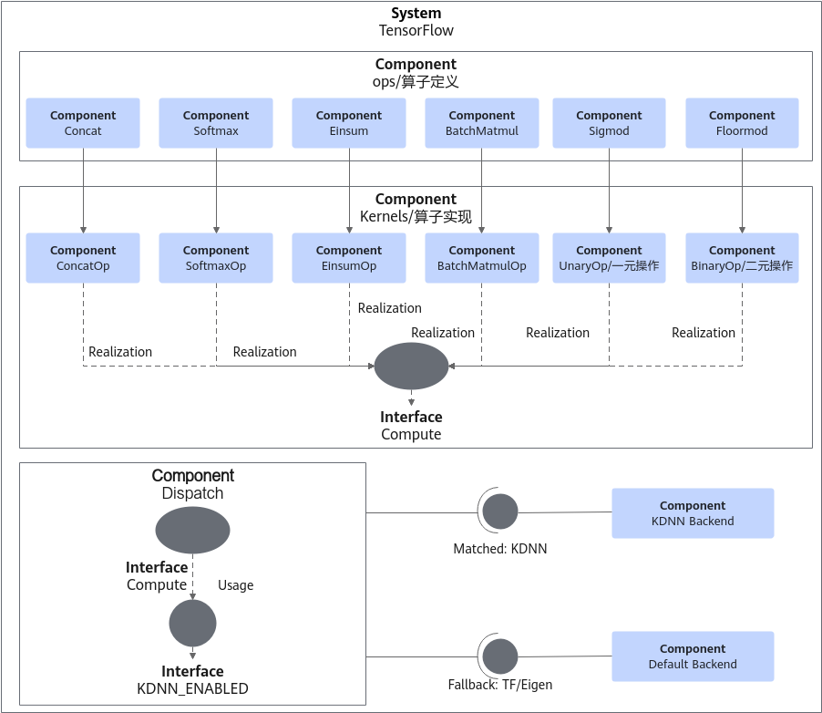

### 规格

本节介绍当前已经支持KDNN算子优化特性的算子及使用规格。

已经支持KDNN算子优化特性的算子约束如[表1 KDNN算子优化特性支持范围](#table8731173784819)所示。

**表 1**  KDNN算子优化特性支持范围

<a name="table8731173784819"></a>

<table><thead align="left"><tr id="row573183720488"><th class="cellrowborder" colspan="2" valign="top" id="mcps1.2.9.1.1"><p id="p06021725181316"><a name="p06021725181316"></a><a name="p06021725181316"></a>算子名称</p>
</th>
<th class="cellrowborder" colspan="4" valign="top" id="mcps1.2.9.1.2"><p id="p106022025191315"><a name="p106022025191315"></a><a name="p106022025191315"></a>数据类型约束</p>
</th>
<th class="cellrowborder" valign="top" id="mcps1.2.9.1.3"><p id="p16011255131"><a name="p16011255131"></a><a name="p16011255131"></a>维度约束</p>
</th>
<th class="cellrowborder" valign="top" id="mcps1.2.9.1.4"><p id="p55991325131312"><a name="p55991325131312"></a><a name="p55991325131312"></a>其他约束</p>
</th>
</tr>
</thead>
<tbody>
<tr id="row19133202192018"><td class="cellrowborder" colspan="2" valign="top" headers="mcps1.2.9.1.1 "><p id="p1033714554132"><a name="p1033714554132"></a><a name="p1033714554132"></a>BatchMatMul</p>
</td>
<td class="cellrowborder" colspan="4" valign="top" headers="mcps1.2.9.1.2 "><p id="p15337165511132"><a name="p15337165511132"></a><a name="p15337165511132"></a>fp32</p>
</td>
<td class="cellrowborder" valign="top" headers="mcps1.2.9.1.3 "><p id="p1833785511316"><a name="p1833785511316"></a><a name="p1833785511316"></a><span>2D-5D</span></p>
</td>
<td class="cellrowborder" valign="top" headers="mcps1.2.9.1.4 "><p id="p26461358164910"><a name="p26461358164910"></a><a name="p26461358164910"></a>无</p>
</td>
</tr>
<tr id="row1663113411277"><td class="cellrowborder" colspan="2" valign="top" headers="mcps1.2.9.1.1 "><p id="p1663113411277"><a name="p1663113411277"></a><a name="p1663113411277"></a>SparseMatmul</p>
</td>
<td class="cellrowborder" colspan="4" valign="top" headers="mcps1.2.9.1.2 "><p id="p563113411727"><a name="p563113411727"></a><a name="p563113411727"></a>fp32</p>
</td>
<td class="cellrowborder" valign="top" headers="mcps1.2.9.1.3 "><p id="p126311341327"><a name="p126311341327"></a><a name="p126311341327"></a>2D</p>
</td>
<td class="cellrowborder" valign="top" headers="mcps1.2.9.1.4 "><p id="p963193412714"><a name="p963193412714"></a><a name="p963193412714"></a>输出矩阵的列数不小于32。</p>
</td>
</tr>
<tr id="row171941117162015"><td class="cellrowborder" colspan="2" valign="top" headers="mcps1.2.9.1.1 "><p id="p5431181116145"><a name="p5431181116145"></a><a name="p5431181116145"></a>Einsum</p>
</td>
<td class="cellrowborder" colspan="4" valign="top" headers="mcps1.2.9.1.2 "><p id="p1943016119149"><a name="p1943016119149"></a><a name="p1943016119149"></a>fp32</p>
</td>
<td class="cellrowborder" valign="top" headers="mcps1.2.9.1.3 "><p id="p1043051115143"><a name="p1043051115143"></a><a name="p1043051115143"></a>无</p>
</td>
<td class="cellrowborder" valign="top" headers="mcps1.2.9.1.4 "><p id="p3659558154917"><a name="p3659558154917"></a><a name="p3659558154917"></a>无</p>
</td>
</tr>
<tr id="row4303415132016"><td class="cellrowborder" colspan="2" valign="top" headers="mcps1.2.9.1.1 "><p id="p5429101117142"><a name="p5429101117142"></a><a name="p5429101117142"></a>Sigmoid</p>
</td>
<td class="cellrowborder" colspan="4" valign="top" headers="mcps1.2.9.1.2 "><p id="p84291211151415"><a name="p84291211151415"></a><a name="p84291211151415"></a>fp32</p>
</td>
<td class="cellrowborder" valign="top" headers="mcps1.2.9.1.3 "><p id="p1342841171412"><a name="p1342841171412"></a><a name="p1342841171412"></a>非空的任意维度</p>
</td>
<td class="cellrowborder" valign="top" headers="mcps1.2.9.1.4 "><p id="p1260874031514"><a name="p1260874031514"></a><a name="p1260874031514"></a>无</p>
</td>
</tr>
<tr id="row1235520136201"><td class="cellrowborder" colspan="2" valign="top" headers="mcps1.2.9.1.1 "><p id="p4427171131419"><a name="p4427171131419"></a><a name="p4427171131419"></a>FloorMod</p>
</td>
<td class="cellrowborder" colspan="4" valign="top" headers="mcps1.2.9.1.2 "><p id="p1042761151418"><a name="p1042761151418"></a><a name="p1042761151418"></a>int64、fp32</p>
</td>
<td class="cellrowborder" valign="top" headers="mcps1.2.9.1.3 "><p id="p154271711181411"><a name="p154271711181411"></a><a name="p154271711181411"></a>非空的任意维度</p>
</td>
<td class="cellrowborder" valign="top" headers="mcps1.2.9.1.4 "><p id="p74261611151414"><a name="p74261611151414"></a><a name="p74261611151414"></a>无</p>
</td>
</tr>
<tr id="row204255116209"><td class="cellrowborder" colspan="2" valign="top" headers="mcps1.2.9.1.1 "><p id="p16426141116147"><a name="p16426141116147"></a><a name="p16426141116147"></a>Softmax</p>
</td>
<td class="cellrowborder" colspan="4" valign="top" headers="mcps1.2.9.1.2 "><p id="p14425141171412"><a name="p14425141171412"></a><a name="p14425141171412"></a>fp32</p>
</td>
<td class="cellrowborder" valign="top" headers="mcps1.2.9.1.3 "><p id="p9425101111146"><a name="p9425101111146"></a><a name="p9425101111146"></a>2D</p>
</td>
<td class="cellrowborder" valign="top" headers="mcps1.2.9.1.4 "><p id="p144231611121419"><a name="p144231611121419"></a><a name="p144231611121419"></a>仅支持沿第二维度（行）执行softmax运算</p>
</td>
</tr>
</tbody>
</table>

### 应用场景

TensorFlow KDNN算子优化特性主要在高并发推理场景中使用，表现在吞吐量的提升和推理时延大幅下降。

### 原理描述

本节针对KDNN算子优化特性进行描述，以帮助用户更好地使用。

#### KDNN线程直通

**图 2**  OMP并行<a name="fig19954351104320"></a><a id="OMP并行示意图"></a>

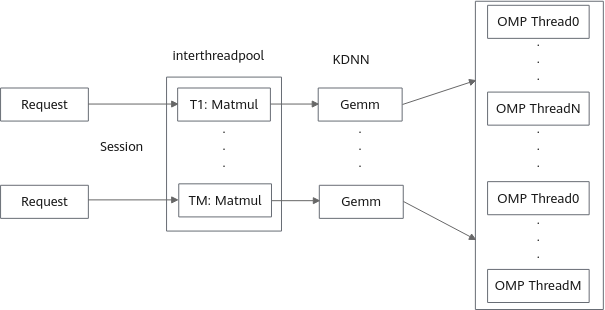

如[**图 2**  OMP并行](#OMP并行示意图)所示，OMP版本的KDNN中，每个算子将创建N个OMP线程计算，M个Kernel并发则会创建M*N个OMP线程。

**图 3**  Threadpool线程直通<a name="fig1203165984517"></a><a id="Threadpool线程直通示意图"></a>

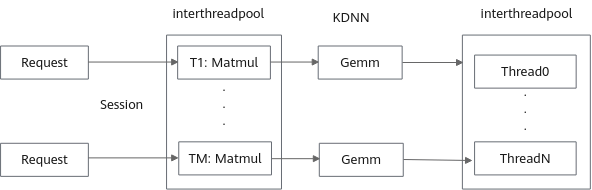

如[**图 3**  Threadpool线程直通](#Threadpool线程直通示意图)所示，使能KDNN算子优化后，KDNN算子支持线程直通：算子的计算任务直接提交到框架线程池统一调度执行，不再单独创建OMP线程，既降低了线程创建销毁的损耗，也避免了并发Kernel数增大时线程数爆炸的问题。直通模式下线程数量由框架线程池统一控制，无需为KDNN算子单独配置线程数。

#### 稀疏矩阵乘稀疏转稠密

**图 4**  稀疏矩阵乘流程图<a name="fig19954351104321"></a><a id="稀疏矩阵乘流程图"></a>

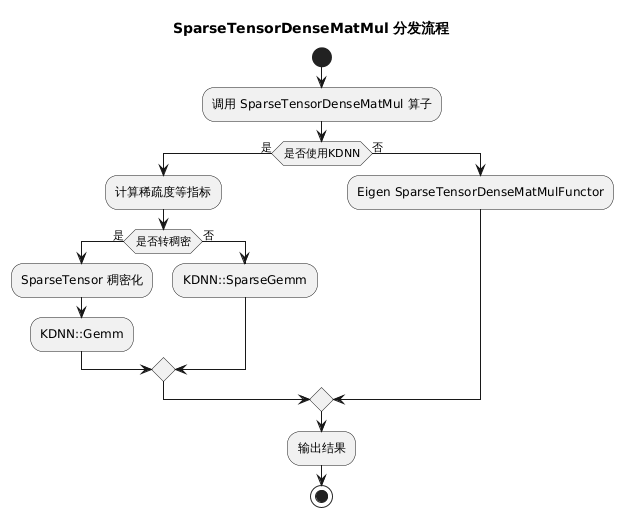

如[**图 4**  稀疏矩阵乘流程图](#稀疏矩阵乘流程图)所示，
优化特性开启条件下，稀疏矩阵乘算子会当非零元素个数不小于8192，且稀疏度不大于0.5时将稀疏矩阵转稠密并使用KDNN::Gemm接口。

## EmbeddingTableLookup算子

### 简介

EmbeddingTableLookup是KEmbedding算子库中的核心算子，用于推荐系统中高效执行稀疏Embedding查找操作。该算子能从预先加载的资源表中按key查找稀疏Embedding，并输出标准SparseTensor三元组（indices、values、dense_shape），具有高性能和低延迟的特点。
典型使用场景是把离线构建好的稀疏embedding表加载到推理进程内存中，然后在推理过程中按一批key执行快速查找，适合推荐模型数据处理层的需求。

### 使用流程

使用EmbeddingTableLookup算子通常需要三个步骤。

1. 调用`EmbeddingIndexToValueTable`创建资源表句柄。
2. 调用`InitializeEmbeddingIndexToValueTableFromTextFile`从二进制文件初始化资源表。
3. 调用`EmbeddingTableLookup`执行批量查找。

其中，`InitializeEmbeddingIndexToValueTableFromTextFile`名称中保留`TextFile`是历史命名，实际读取的输入文件不是文本文件，而是KEmbedding二进制表文件。

### 文件与内存组织

Embedding表文件由两部分组成。

- 文件头：保存`total_key_size`、字节序等元信息。
- 数据区：每个key依次保存有效维度个数、有效维度索引数组、对应float值数组。

加载完成后，资源表内部按分桶方式保存。

- 外层为固定bucket数量的`std::vector`。
- 每个bucket内部使用`absl::flat_hash_map<uint64_t, EmbeddingValue>`。
- value为若干`(valid_value_index, valid_value)`对。

### 示例说明

假设构建为以下内容。

- key `101` -> `(0, 1.0)`、`(2, 3.0)`
- key `202` -> `(1, 2.5)`

使用如下输入进行查找。

```python
keys = [101, 202, 999]  
emb_dim = 4
```

输出结果为。

```python
indices = [[0, 0], [0, 2], [1, 1]]
values = [1.0, 3.0, 2.5]
dense_shape = [3, 4]  
```

### ARM优化设计

在ARM64平台上，EmbeddingTableLookup算子进行了以下多方面优化，这些优化使得EmbeddingTableLookup算子在ARM平台上的性能大幅提升，适合高并发的推荐模型推理场景。

**按key分片并行查找**

- 通过TensorFlow shard并行方法将key向量切分给多个worker线程。
- 每个线程负责一个区间内的key查找，适合批量请求场景。

**减少内存分配和扩容成本**

- 原方法通过`reserve(key_cnt * emb_dim)`按“最大可能值”预留内存，实际结果通常远小于这个值，导致内存浪费。
- 优化实现先通过`shard_results`做一遍计数，得到精确的`value_tensor_size`，然后一次性分配最终输出。

**去掉中间vector缓冲，直接写Tensor**

- 原方法先把结果攒到中间vector，最后再复制到输出Tensor。
- 优化实现先统计总大小，直接分配输出Tensor，然后直接写入结果，减少额外的内存复制开销。

## TensorFlow ANNC静态图融合

### 简介

本章节介绍了TensorFlow ANNC静态图融合优化特性的基本概念和实现原理。

为提升TensorFlow推理性能，鲲鹏BoostKit提出了TensorFlow ANNC静态图融合优化方案。鲲鹏BoostKit提供了多个自定义算子，在图优化阶段利用remapper机制将符合特定特征的计算子图替换为自定义算子。静态图融合通过消除中间内存开销、优化访存逻辑等，实现端到端的性能提升。

**ANNC 静态图融合包含两类算子**：

**CPU 算子（面向 CPU 推理场景的 Embedding 融合算子）**：

- KPFusedEmbeddingActionIdGather
- KPFusedGather
- KPFusedEmbeddingPadding
- KPFusedEmbeddingPaddingFast
- KPFusedSparseDynamicStitch
- KPFusedSparseDynamicStitchSum/Mean/SqrtN（含Fast变体）
- KPFusedSparseReshape
- KPFusedSparseSegmentReduce
- KPFusedSparseSegmentReduceNonzero
- KPFusedSparseSelect

**GPU 算子（面向 GPU 推理场景的 FlashAttention 融合算子，需 CUDA 环境）**：

- FlashAttentionForward

ANNC静态图融合特性开关通过代码补丁的方式接入TensorFlow，基于TensorFlow v2.20版本增加。
开启ANNC静态图融合特性条件下，如果计算图子图符合特定结构并且输入输出满足约束，会在图优化阶段将符合要求的子图替换为对应的自定义算子。

### 软件架构

ANNC静态图融合软件架构图如[图5](#fig4919356463)所示。

**图 5**  ANNC静态图融合软件架构图<a name="fig4919356463"></a>

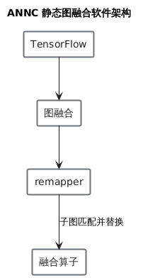

### 规格

本节介绍当前已经支持自定义算子及使用约束。

#### CPU算子

##### KPFusedEmbeddingActionIdGather算子

**开源子图结构**

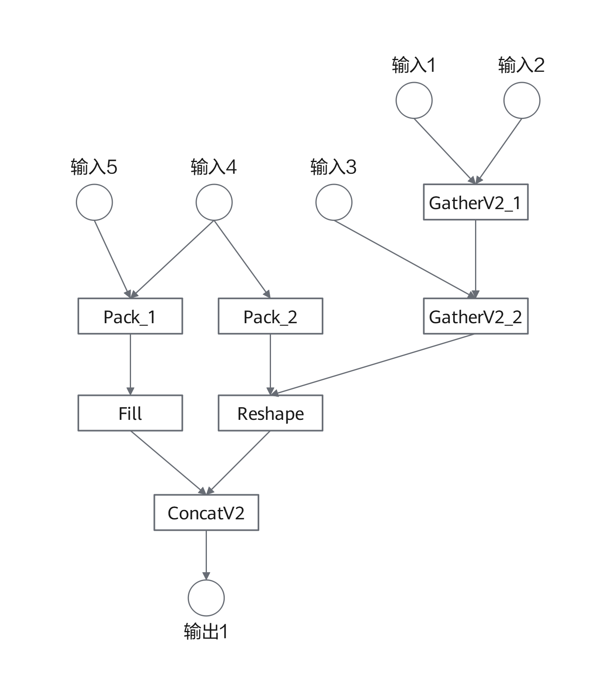

**输入输出约束**

| 输入名称 | 数据类型    | 形状    |
| -------- | ----------- | ------- |
| 输入1    | int32/int64 | 2维张量 |
| 输入2    | float       | 2维张量 |
| 输入3    | int32/int64 | 2维张量 |
| 输入4    | int32       | 标量    |
| 输入5    | int32       | 标量    |

| 输出名称 | 数据类型 |
| -------- | -------- |
| 输出1    | float    |

##### KPFusedGather算子

**开源子图结构**

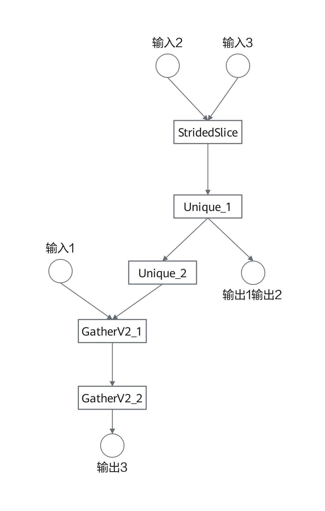

**输入输出约束**

| 输入名称 | 数据类型 | 形状    |
| -------- | -------- | ------- |
| 输入1    | float    | 2维张量 |
| 输入2    | int64    | 2维张量 |
| 输入3    | int32    | [2]     |

| 输出名称 | 数据类型 |
| -------- | -------- |
| 输出1    | int64    |
| 输出2    | int32    |
| 输出3    | float    |

##### KPFusedEmbeddingPadding算子

**开源子图结构**

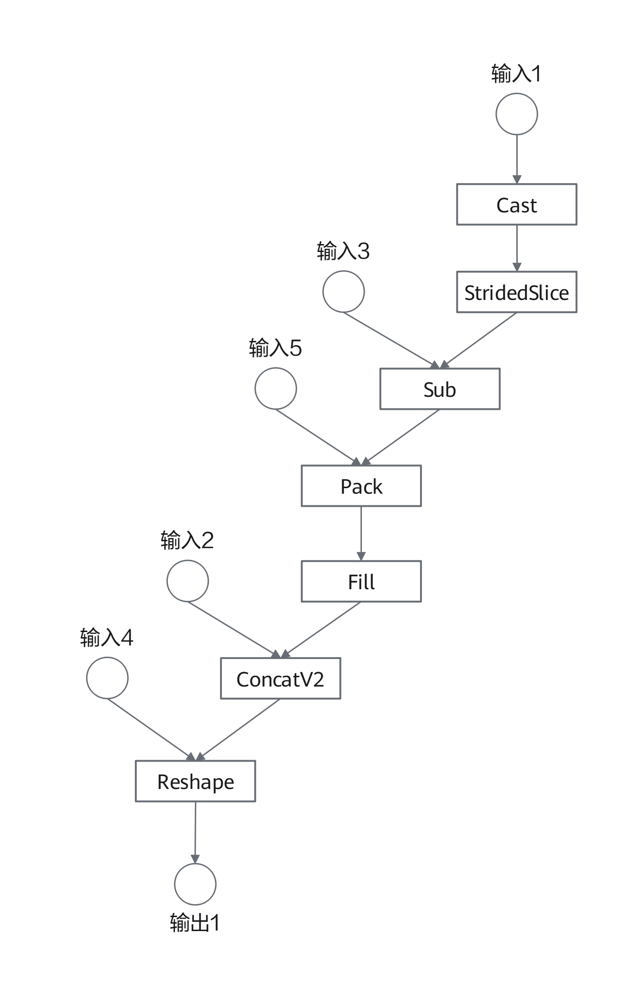

**输入输出约束**

| 输入名称 | 数据类型 | 形状    |
| -------- | -------- | ------- |
| 输入1    | int64    | [2]     |
| 输入2    | float    | 2维张量 |
| 输入3    | int32    | 标量    |
| 输入4    | int32    | [2]     |
| 输入5    | int32    | 标量    |

| 输出名称 | 数据类型 |
| -------- | -------- |
| 输出1    | int32    |
| 输出2    | float    |

##### KPFusedEmbeddingPaddingFast算子

**开源子图结构**

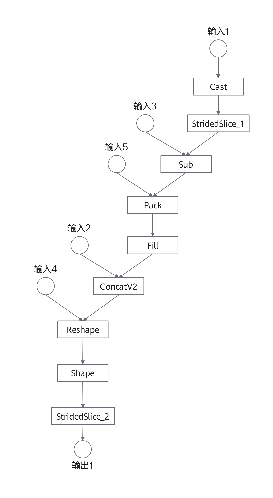

**输入输出约束**

| 输入名称 | 数据类型 | 形状    |
| -------- | -------- | ------- |
| 输入1    | int64    | [2]     |
| 输入2    | float    | 2维张量 |
| 输入3    | int32    | 标量    |
| 输入4    | int32    | [2]     |
| 输入5    | int32    | 标量    |

| 输出名称 | 数据类型 |
| -------- | -------- |
| 输出1    | int32    |
| 输出2    | int32    |

##### KPFusedSparseDynamicStitch算子

**开源子图结构**

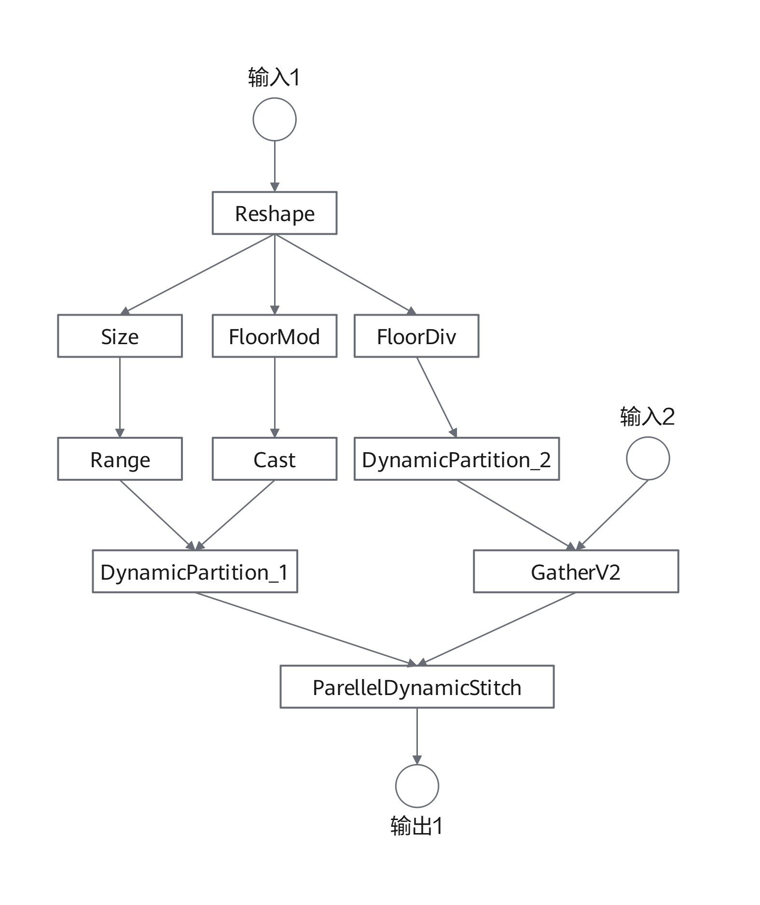

**输入输出约束**

| 输入名称 | 数据类型 | 形状              |
| -------- | -------- | ----------------- |
| 输入1    | int64    | 张量              |
| 输入2    | float    | 非空的2维张量列表 |

| 输出名称 | 数据类型 |
| -------- | -------- |
| 输出1    | float    |

##### KPFusedSparseDynamicStitchSum/Mean/SqrtN算子

**开源子图结构**

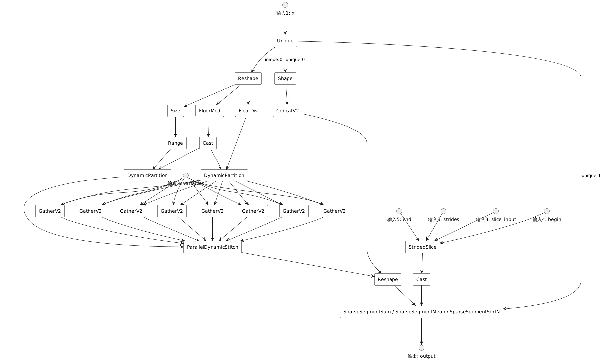

KPFusedSparseDynamicStitchSum/Mean/SqrtN算子融合的是“ParallelDynamicStitch + SparseSegmentSum/SparseSegmentMean/SparseSegmentSqrtN”构成的按段归约子图，将多个embedding表的分片收集、拼接以及按段归约（求和、求均值或按sqrt(N)缩放）合并为一个融合算子。当参与拼接的embedding表数量为2的幂时，图优化器会自动选择访存更优的Fast变体（KPFusedSparseDynamicStitchFastSum/FastMean/FastSqrtN）。

**输入输出约束**

| 输入名称 | 数据类型 | 形状 |
| -------- | -------- | ---- |
| 输入1    | int64    | 张量 |
| 输入2    | float    | 非空的2维张量列表 |
| 输入3    | int64    | 2维张量 |
| 输入4    | int32    | [2]  |
| 输入5    | int32    | [2]  |
| 输入6    | int32    | [2]  |

| 输出名称 | 数据类型 |
| -------- | -------- |
| 输出1    | float    |

##### KPFusedSparseReshape算子

**开源子图结构**

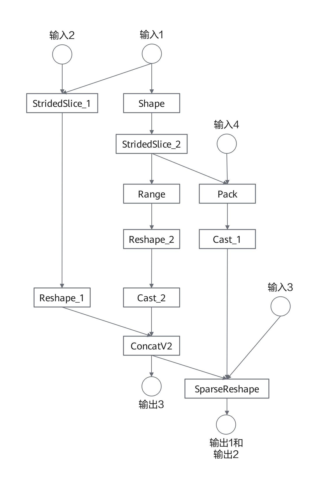

**输入输出约束**

| 输入名称 | 数据类型    | 形状    |
| -------- | ----------- | ------- |
| 输入1    | int64       | 2维张量 |
| 输入2    | int32       | [2]     |
| 输入3    | int64       | [2]     |
| 输入4    | int32/int64 | 标量    |

| 输出名称 | 数据类型 |
| -------- | -------- |
| 输出1    | int64    |
| 输出2    | int64    |

##### KPFusedSparseSegmentReduce算子

**开源子图结构**

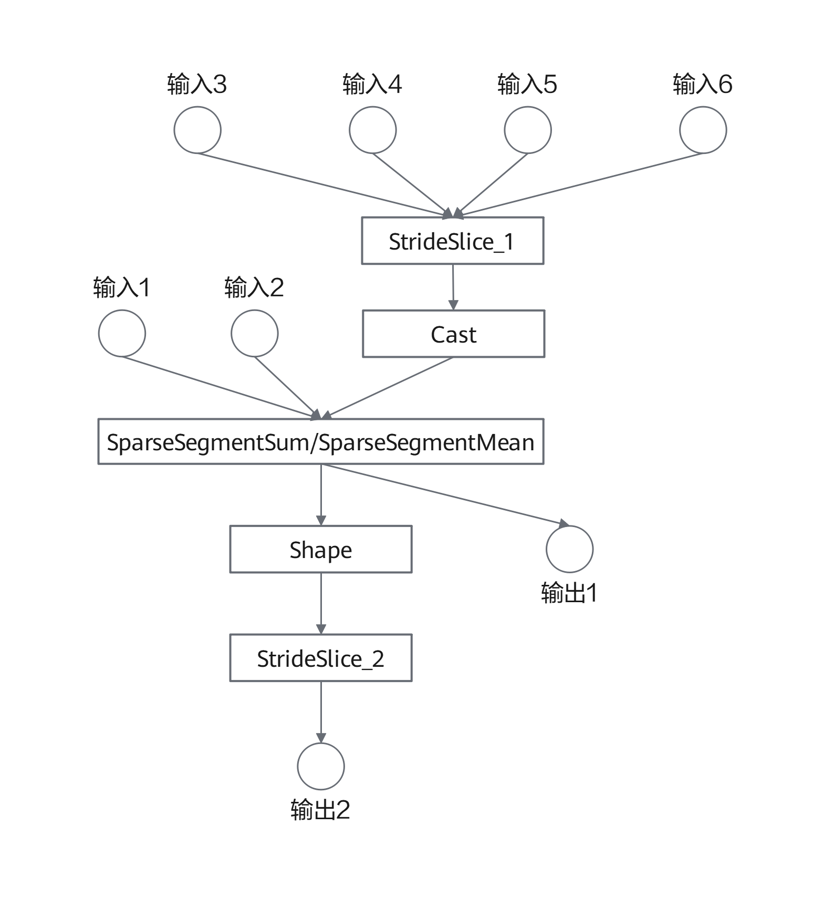

**输入输出约束**

| 输入名称 | 数据类型    | 形状    |
| -------- | ----------- | ------- |
| 输入1    | float       | 2维张量 |
| 输入2    | int32/int64 | 1维张量 |
| 输入3    | int64       | 2维张量 |
| 输入4    | int32       | [2]     |
| 输入5    | int32       | 标量    |

| 输出名称 | 数据类型 |
| -------- | -------- |
| 输出1    | float    |
| 输出2    | int32    |

##### KPFusedSparseSegmentReduceNonzero算子

**开源子图结构**

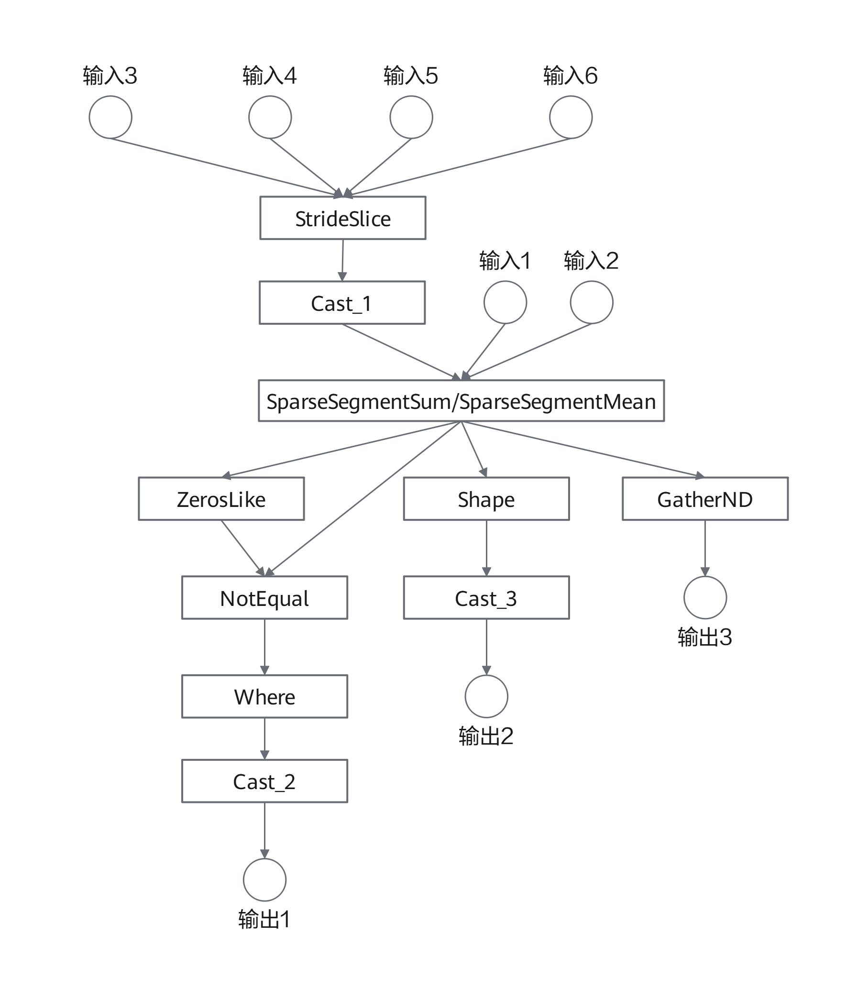

**输入输出约束**

| 输入名称 | 数据类型    | 形状    |
| -------- | ----------- | ------- |
| 输入1    | float       | 1维张量 |
| 输入2    | int32/int64 | 1维张量 |
| 输入3    | int64       | 2维张量 |
| 输入4    | int32       | [2]     |

| 输出名称 | 数据类型 |
| -------- | -------- |
| 输出1    | int32    |
| 输出2    | int32    |
| 输出3    | float    |

##### KPFusedSparseSelect算子

**开源子图结构**

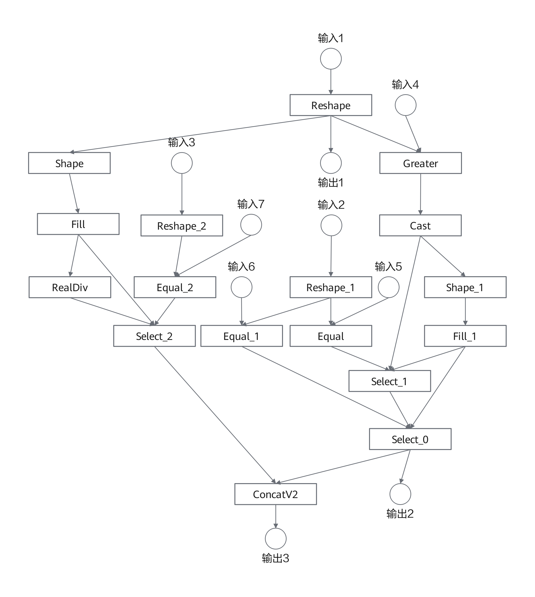

**输入输出约束**

| 输入名称 | 数据类型 | 形状 |
| -------- | -------- | ---- |
| 输入1    | int32    | 张量 |
| 输入2    | int32    | 张量 |
| 输入3    | int32    | 张量 |
| 输入4    | int32    | 标量 |
| 输入5    | int32    | 标量 |
| 输入6    | int32    | 标量 |
| 输入7    | int32    | 标量 |

| 输出名称 | 数据类型 |
| -------- | -------- |
| 输出1    | int32    |
| 输出2    | float    |
| 输出3    | float    |

#### GPU算子

##### FlashAttentionForward算子

**开源子图结构**

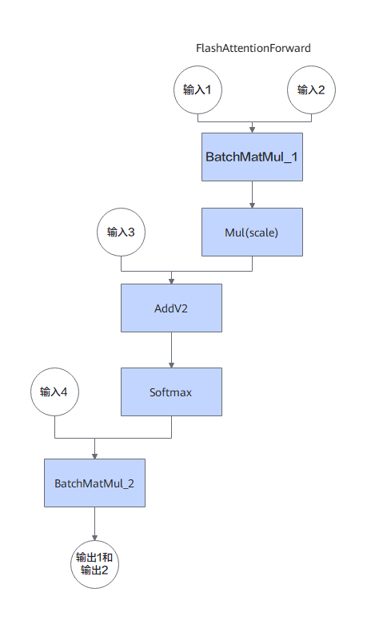

**输入输出约束**

| 输入名称 | 数据类型    | 形状    |
| -------- | ----------- | ------- |
| 输入1    | float       | 3维张量 |
| 输入2    | float       | 3维张量 |
| 输入3    | float       | 3维张量 |
| 输入4    | float       | 2维张量 |

| 输出名称 | 数据类型 | 形状    |
| -------- | -------- | ------- |
| 输出1    | float    | 3维张量 |
| 输出2    | float    | 2维张量 |

**该算子为 GPU 算子，需 CUDA 环境支持**。

>  **说明：**
> 开启Embedding算子融合条件下，如果存在符合要求的子图则会在图优化阶段替换为对应的自定义算子，否则使用TensorFlow开源接口。

### 应用场景

TensorFlow ANNC静态图融合主要在高并发推理场景中使用，表现在吞吐量的提升和推理时延大幅下降。

- **CPU 算子**：适用于纯 CPU 推理场景，优化 Embedding 层计算。
- **GPU 算子**：适用于 GPU 推理场景，需 CUDA 环境支持。

### 原理描述

本节针对ANNC静态图融合优化特性进行描述，以帮助用户更好地使用。

使能ANNC静态图融合后，会在图优化阶段将符合要求的子图替换为对应的自定义算子，进而减少中间内存开销、优化访存逻辑等，实现端到端的性能提升。

**图 6**  算子融合原理图<a name="fig4919356474"></a>

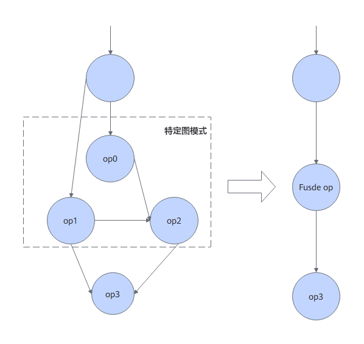

## 修订记录

| 文档版本 | 发布日期 | 修改说明 |
| ---- | ---- | ---- |
| 02 | 2026-12-30 | 第二次正式发布。<ul><li>新增TensorFlow KDNN算子优化特性，增加对应特性介绍、软件架构等内容。</li><li>新增KEmbedding算子库EmbeddingTableLookup算子特性介绍内容。</li><li>新增TensorFlow ANNC静态图融合特性，增加对应特性介绍、软件架构等内容。</li></ul> |
| 01 | 2026-09-30 | 第一次正式发布。 <ul><li>新增TensorFlow FAGO静态图融合特性，增加对应特性介绍、软件架构等内容。</li></ul> |
