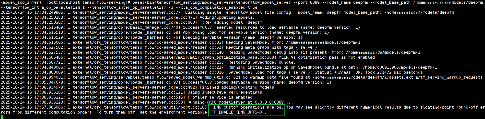

# 快速入门

## 安装鲲鹏TensorFlow

1. 获取鲲鹏TensorFlow补丁仓。

   ```bash
   git clone -b master https://gitcode.com/boostkit/tensorflow.git kunpeng-tensorflow
   cd kunpeng-tensorflow
   ```

2. 获取官方TensorFlow v2.20.0基线。

   ```bash
   git remote add tensorflow-upstream https://github.com/tensorflow/tensorflow.git
   git fetch tensorflow-upstream refs/tags/v2.20.0:refs/tags/v2.20.0
   ```

3. 创建完整默认特性的TensorFlow源码。

   ```bash
   python3 patches/Tensorflow_V2.20.0/prepare_source.py \
     --feature-set full-default \
     --output-dir ../tensorflow-full-default
   ```

   其他可用组合的使用指导，请参见《[补丁发布说明](../../../patches/Tensorflow_V2.20.0/README.md)》。

4. 根据实际使用场景选择需要的构建目标，无需同时构建全部目标。以下提供pip构建目标的参考命令。

   4.1. 配置bazel。

      ```bash
      cd ../tensorflow-full-default
      ./configure
      You have bazel 7.4.1 installed.
      Please specify the location of python. [Default is /usr/bin/python3]: 


      Found possible Python library paths:
      /usr/lib/python3.11/site-packages
      /usr/lib64/python3.11/site-packages
      /usr/local/lib/python3.11/site-packages
      /usr/local/lib64/python3.11/site-packages
      Please input the desired Python library path to use.  Default is [/usr/lib/python3.11/site-packages]

      Do you wish to build TensorFlow with ROCm support? [y/N]: n
      No ROCm support will be enabled for TensorFlow.

      Do you wish to build TensorFlow with CUDA support? [y/N]: y
      CUDA support will be enabled for TensorFlow.

      Please specify the hermetic CUDA version you want to use or leave empty to use the default version. 12.8.0


      Please specify the hermetic cuDNN version you want to use or leave empty to use the default version. 9.5.0


      Please specify a list of comma-separated CUDA compute capabilities you want to build with.
      You can find the compute capability of your device at: https://developer.nvidia.com/cuda-gpus. Each capability can be specified as "x.y" or "compute_xy" to include both virtual and binary GPU code, or as "sm_xy" to only include the binary code.
      Please note that each additional compute capability significantly increases your build time and binary size, and that TensorFlow only supports compute capabilities >= 3.5 [Default is: 3.5,7.0]: 8.9


      Please specify the local CUDA path you want to use or leave empty to use the default version. 


      Please specify the local CUDNN path you want to use or leave empty to use the default version. 


      Please specify the local NCCL path you want to use or leave empty to use the default version. 


      Do you want to use clang as CUDA compiler? [Y/n]: n
      nvcc will be used as CUDA compiler.

      Please specify which gcc should be used by nvcc as the host compiler. [Default is /usr/bin/gcc]: 


      Please specify optimization flags to use during compilation when bazel option "--config=opt" is specified [Default is -Wno-sign-compare]: 


      Would you like to interactively configure ./WORKSPACE for Android builds? [y/N]: n
      Not configuring the WORKSPACE for Android builds.

      Preconfigured Bazel build configs. You can use any of the below by adding "--config=<>" to your build command. See .bazelrc for more details.
            --config=mkl            # Build with MKL support.
            --config=mkl_aarch64    # Build with oneDNN and Compute Library for the Arm Architecture (ACL).
            --config=monolithic     # Config for mostly static monolithic build.
            --config=numa           # Build with NUMA support.
            --config=dynamic_kernels        # (Experimental) Build kernels into separate shared objects.
            --config=v1             # Build with TensorFlow 1 API instead of TF 2 API.
      Preconfigured Bazel build configs to DISABLE default on features:
            --config=nogcp          # Disable GCP support.
            --config=nonccl         # Disable NVIDIA NCCL support.
      Configuration finished
      ```

   4.2. 打开`.tf_configure.bazelrc`，在`build --action_env LD_LIBRARY_PATH=...`行前添加以下build 配置。

      ```bash
      build:cuda --repo_env TF_NEED_CUDA=1
      build:cuda --crosstool_top=@local_config_cuda//crosstool:toolchain
      build:cuda --@local_config_cuda//:enable_cuda
      build:cuda --config=cuda_version
      ```

   4.3. 构建TensorFlow pip包。

     ```bash
     bazel build \
      --experimental_repo_remote_exec \
      --verbose_failures \
      --config=cuda --config=cuda_nvcc --config=cuda_wheel \
      --cxxopt=-std=c++17 --host_cxxopt=-std=c++17 \
      --copt=-march=armv8.5-a --linkopt=-fuse-ld=gold \
      --config=opt \
      --define=enable_kdnn=true \
      --action_env=CLANG_CUDA=0 \
      --repo_env=CLANG_CUDA=0 \
      --repo_env=PIP_INDEX_URL=https://mirrors.aliyun.com/pypi/simple/ \
      --repo_env=PIP_TRUSTED_HOST=mirrors.aliyun.com \
      --@local_config_cuda//cuda:override_include_cuda_libs=true \
      --repo_env=CC=/usr/bin/gcc \
      --repo_env=CXX=/usr/bin/g++ \
      --repo_env=CUDA_PATH=/usr/local/cuda-12.8 \
      //tensorflow/tools/pip_package:wheel
     ```

   4.4. 安装TensorFlow pip包。
  
     ```bash
     pip install bazel-bin/tensorflow/tools/pip_package/wheel_house/tensorflow-2.20.0.dev0+selfbuilt-cp311-cp311-linux_aarch64.whl
     ```

5. 调用Tensorflow接口。

   5.1. C++接口调用，预期可以输出Tensorflow C++共享库依赖的系统动态库。

     ```bash
     ldd /usr/local/lib64/python3.11/site-packages/tensorflow/libtensorflow_cc.so.2
     ```

   5.2. Python接口调用，预期可以输出tensorflow lib路径。

     ```bash
     cd ..
     python3 -c "import tensorflow; print(tensorflow.sysconfig.get_lib())"
     ```

如果在编译过程中遇到任何问题，请参见《[TensorFlow 移植指南](https://www.hikunpeng.com/document/detail/zh/SRA/ecosystemEnable/TensorFlow/kunpengtensorflow_02_0001.html)》。

## 运行推理服务

鲲鹏TensorFlow可以作为TensorFlow依赖，集成到推理服务中。当前版本支持基于开源TensorFlow Serving，构建在线推理服务。

### TensorFlow Serving

使用前需基于本仓库生成的完整TensorFlow源码编译TensorFlow Serving。完整流程请参见《[安装指南](./installation_guide.md#构建tensorflow-serving)》。

#### 使用KDNN算子优化

KDNN（Kunpeng Deep Neural Network Library，鲲鹏DNN库）是华为提供的基于鲲鹏平台进行优化的高性能AI算子库。其中MatMul、FusedMatMul、SparseMatMul算子已经适配TensorFlow。集成KDNN可以降低NN类算子的时延，增强模型推理性能。

1. 启动服务端。

    ```bash
    numactl -N 0 /path/to/serving/bazel-bin/tensorflow_serving/model_servers/tensorflow_model_server --port=8889 --model_name=deepfm --model_base_path=/path/to/model_zoo/models/deepfm
    ```

    > **说明：**
    >**numactl -N 0**表示将程序绑定到第0个NUMA节点上运行。

2. 启动客户端性能测试。

    ```bash
    docker run -it --rm --cpuset-cpus="$(cat /sys/devices/system/node/node0/cpulist)" --cpuset-mems="0" --net host  nvcr.io/nvidia/tritonserver:24.05-py3-sdk perf_analyzer --concurrency-range 28:28:1 -p 8000 -f perf.csv -m deepfm --service-kind tfserving -i grpc --request-distribution poisson -b 128  -u localhost:8889 --percentile 99 --input-data=random
    ```

    > **说明：**
    >--cpuset-cpus：设置容器绑定的CPU核编号。
    >--cpuset-mems：设置容器绑定的NUMA内存节点。

    性能测试启动后，服务端显示“KDNN custom operations are on. You may see slightly different numerical results due to floating-point round-off errors from different computation orders. To turn them off, set the environment variable \`TF\_ENABLE\_KDNN\_OPTS=0\`”字样，即表示使能成功。

    KDNN默认使能，可以通过设置环境变量TF\_ENABLE\_KDNN\_OPTS=0关闭KDNN。

    其中SparseMatmul算子的转稠密路径默认开启，可以通过设置环境变量TF\_ENABLE\_KDNN\_SPARSE\_MATMUL\_TO\_DENSE=0单独关闭，具体说明参见《[API参考](./api_reference.md)》。

    

#### 使用ANNC静态图融合

鲲鹏TensorFlow ANNC静态图融合特性提供了环境变量开关，即算子可单独开启融合以及算子可全部开启融合。本章节仅提供使用样例，具体使用说明参见《[API参考](./api_reference.md)》。

1. 启动服务端。

    ```bash
    numactl -N 0  ANNC_FUSED_ALL=1 /path/to/serving/bazel-bin/tensorflow_serving/model_servers/tensorflow_model_server --port=8889 --model_name=deepfm --model_base_path=/path/to/model_zoo/models/deepfm
    ```

    > **说明：**
    >**numactl -N 0**表示将程序绑定到第0个NUMA节点上运行。

2. 启动客户端性能测试。

    ```bash
    docker run -it --rm --cpuset-cpus="$(cat /sys/devices/system/node/node0/cpulist)" --cpuset-mems="0" --net host  nvcr.io/nvidia/tritonserver:24.05-py3-sdk perf_analyzer --concurrency-range 28:28:1 -p 8000 -f perf.csv -m deepfm --service-kind tfserving -i grpc --request-distribution poisson -b 128  -u localhost:8889 --percentile 99 --input-data=random
    ```

    > **说明：**
    >--cpuset-cpus：设置容器绑定的CPU核编号。
    >--cpuset-mems：设置容器绑定的NUMA内存节点。

本章节仅为使用样例，由于ANNC静态图融合功能需要模型中包含特定子图，若模型中不包含特定子图，则ANNC静态图融合功能不会生效。可以通过运行benchmark测试，用样例验证是否成功集成了ANNC静态图融合特性。

## 修订记录

| 文档版本 | 发布日期 | 修改说明 |
| ---- | ---- | ---- |
| 02 | 2026-12-30 | 第二次正式发布。<ul><li>新增基于TensorFlow Serving的推理服务使用指导，提供KDNN算子优化和ANNC静态图融合的使用样例。</li></ul> |
| 01 | 2026-09-30 | 第一次正式发布。<ul><li>新增TensorFlow 2.20.0的安装与调用指导内容。</li></ul> |
